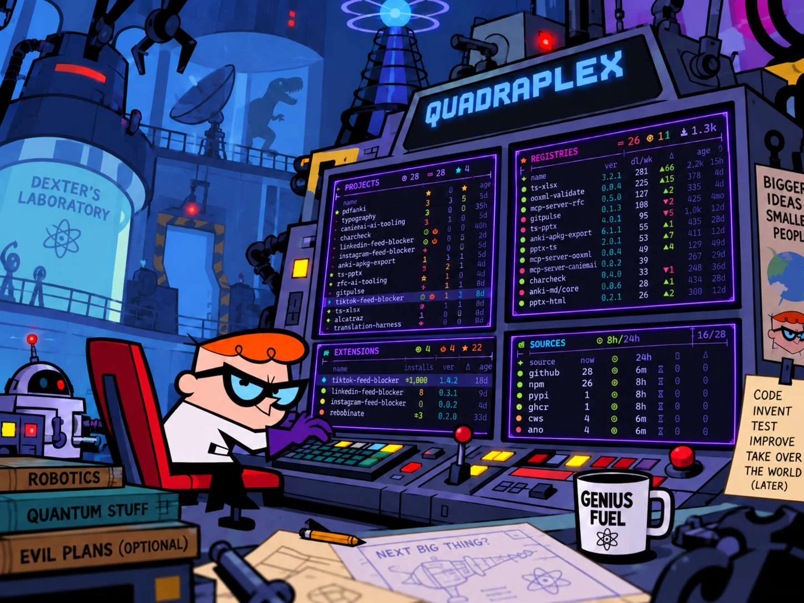
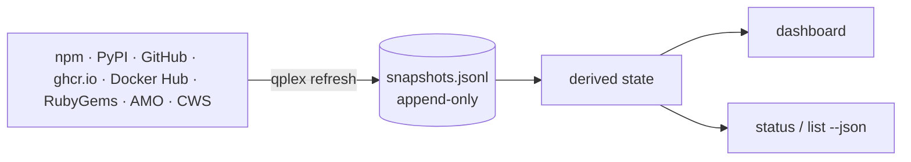

<div align="center">




Monitor your development projects like an evil genius.

[](LICENSE)

---

**[<kbd> <br> Install <br> </kbd>][Install]**
**[<kbd> <br> Quickstart <br> </kbd>][Quickstart]**
**[<kbd> <br> For agents <br> </kbd>][For agents]**
**[<kbd> <br> Docs <br> </kbd>][Docs]**

---

</div>


quadraplex collects your npm and PyPI packages, Ruby gems, ghcr.io and Docker Hub images, browser extensions and GitHub repos into one local store.
A terminal dashboard shows each metric against a baseline, and a JSON surface answers agents from the same cache.

Named after the Quadraplex T-3000, the computer that oversees the lab in _Dexter's Laboratory_.
It reports on the facility. It does not run it.

- **Deltas, not totals.** "+120 downloads since Aug 19" instead of a number you have to remember.
- **Instant dashboard.** The TUI reads the local store and never fetches, so it works offline.
- **One pane per group of ecosystems.** GitHub, registries and extension stores, plus agent skills once ClawHub is set, with a sources panel showing how old each ecosystem's data is.
- **Drift between ecosystems.** Chrome on 1.4.0 and Firefox on 1.4.1 shows on the row, and so do commits pushed after the last release.
- **Built for agents.** Cached JSON answers most questions with zero requests. Only single-target lookups may refetch.
- **No token required.** Public data only. A GitHub token raises rate limits and is never needed.

## What it tracks

| Source                                                                                          | Information                      | Discovered from                        |
| ----------------------------------------------------------------------------------------------- | -------------------------------- | -------------------------------------- |
|  npm                              | packages                         | your npm username                      |
|  PyPI                          | packages                         | your PyPI username                     |
|  GitHub           | repos, releases and agent skills | your public repos                      |
|  ghcr.io                                | images                           | your ghcr.io owner                     |
|  Docker Hub                    | images                           | your Docker Hub namespace              |
|  RubyGems                    | gems                             | your RubyGems handle                   |
|  Firefox Add-ons (AMO) | extensions                       | your numeric author id                 |
|  Chrome Web Store        | extensions                       | the "Offered by" name on your listings |
| ClawHub                                                                                         | agent skills                     | your ClawHub publisher handle          |

Anything discovery misses, like an unlisted Chrome extension, goes in the config's `include` list.

## Install

```sh
npm install -g quadraplex
```

This installs `quadraplex` and its short alias `qplex`.

## Quickstart

1. Run `qplex`.
   The first launch opens the accounts screen, prefilled from your gh or git login, and shows what each ecosystem holds for you.
2. Edit any row that's wrong, then save.
   This writes the config and runs the first refresh.
3. The dashboard opens. Press `?` for every key and symbol.
4. Later, run `qplex refresh` to fetch new data. It's the only command that touches the network.

To skip the accounts screen, write the accounts directly:

```sh
qplex init --github you --npm you
```

The config lives at `~/.config/quadraplex/config.json`. Archived repos, forks and deprecated packages are hidden by default. See [Config](docs/architecture.md#config) for every key.

Icons come from a [Nerd Font](https://www.nerdfonts.com). Without one, set `QUADRAPLEX_ASCII=1`.

Bash completion covers commands, flags and the target names in your store, read from cache. Add this to `~/.bashrc`:

```sh
eval "$(qplex completions bash)"
```

## For agents

Point your agent at the snapshot, not the network.
This prints a compact index of everything from cache:

```sh
qplex status --json
```

This prints one target, and `--fresh` refetches only that one:

```sh
qplex npm your-pkg --json --fresh
```

`--fresh` requires a target on purpose. Refetching the whole portfolio through the JSON surface is how rate limits die.

An installable skill teaches an agent this access strategy:

```sh
npx skills add shbernal/quadraplex
```

## How it works



Every refresh appends snapshots to a local log, which is the source of truth.
Everything else is derived from it and can be deleted at the cost of requests, never data.
Deltas compare the latest snapshot against a time-anchored baseline.

## Docs

- [Commands](docs/commands.md): every command, flag and the JSON contract
- [Architecture](docs/architecture.md): store, deltas, drift, staleness and config
- [GitHub](docs/github.md): rate limits, the issue and PR split, star curves
- [Decisions](docs/adr/): what was decided and when to revisit it
- [Contributing](CONTRIBUTING.md)

[Install]: #install
[Quickstart]: #quickstart
[For agents]: #for-agents
[Docs]: #docs
